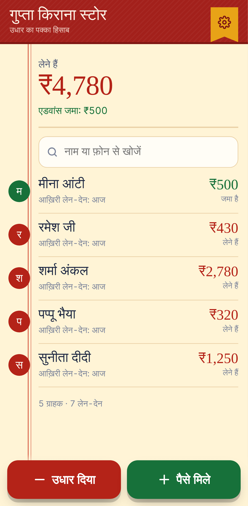
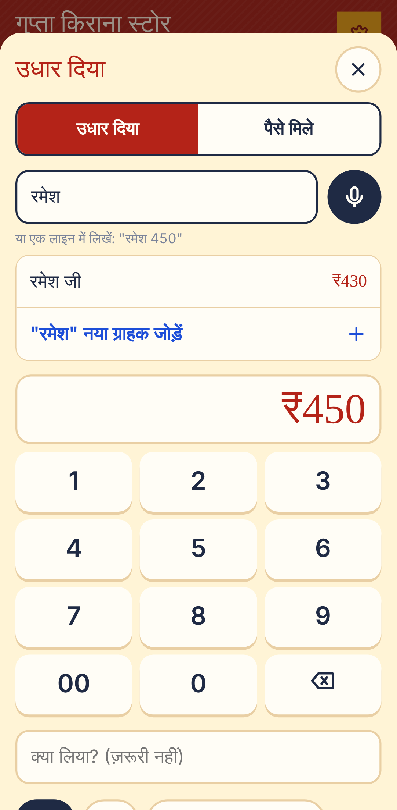
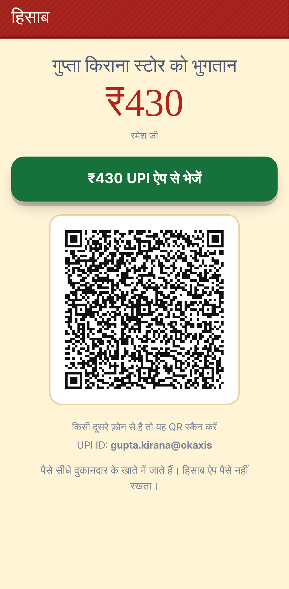

<div align="center">

# हिसाब · Hisaab

**उधार का पक्का हिसाब: a free, offline-first udhaar khata for kirana shops, dairies and small businesses in India.**

[Open the app](https://sumit200531.github.io/hisaab/) · [How it works](docs/ARCHITECTURE.md) · [Deploy](docs/DEPLOY.md) · [Getting real users](docs/LAUNCH.md)

  

</div>

Most small shops in India still give goods on credit (udhaar) and track it in a red cloth register, or not at all. Money is lost to forgotten entries, arguments over "kitna baaki hai?", and awkward reminders. Hisaab puts that register on the cheapest Android phone:

- **Record udhaar in three taps.** Pick the customer, type the amount on a big calculator keypad, save. You can also say or type it in one line: *"रमेश साढ़े चार सौ"* becomes Ramesh, ₹450.
- **Collect with one tap.** A WhatsApp reminder in Hindi or English carries a link to a pay page with a UPI QR code and a "pay with any UPI app" button. Money goes straight to the shopkeeper; Hisaab never touches it.
- **Works with no internet.** The app installs to the home screen and runs fully offline. It is about 80 KB gzipped on first load.
- **Never lose the khata.** Back it up by sending an encrypted file to yourself on WhatsApp, or link a second phone so the family member at the counter sees the same register.
- **Private by design.** Everything that leaves the phone is encrypted on the phone first. The sync server stores ciphertext it cannot read, so nobody, including whoever runs the server, can see a shop's customers or amounts.
- **Large and simple.** Hindi-first, 18 px body text, big tap targets (the main buttons are 56–64 px tall), high contrast, and undo for every entry.

## Try it

Open **https://sumit200531.github.io/hisaab/** on a phone and choose *Add to home screen*. No sign-up, no account and no data leaves the phone unless you turn on sync.

## The engineering

| Problem | Approach |
|---|---|
| Two phones edit the same khata offline, then meet | An **operation-based CRDT**. Every change is an immutable operation stamped with a hybrid logical clock. The screen is a pure function of the set of operations, so any delivery order (with duplicates and gaps) converges to the same balances. Randomised tests run 60 three-phone histories and assert byte-identical state. |
| Phone clocks are wrong | **Hybrid logical clocks** keep "last edit wins" correct even when a phone is an hour behind, and a clock days in the future cannot poison other phones. |
| Money must be exact | Amounts are **integer paise** and entries are never edited. A mistake is cancelled with a tombstone, so history stays auditable and balances never drift. |
| Sync over 2G that drops mid-way | **Version vectors**: one pull and one push per sync, both idempotent, paged and batched. An interrupted sync is simply retried. |
| The server must not see shop data | A 120-bit **sync code** goes through HKDF to give three keys: an AES-256-GCM key, a public shop id, and a write token the server stores only as SHA-256. Each operation is encrypted separately and **bound to its device and sequence number** as AEAD data, so the server cannot read, forge, swap or re-label entries. |
| People speak amounts in Hindi | A parser for *डेढ़ सौ*, *ढाई हज़ार*, *साढ़े चार सौ*, *सवा लाख*, *पौने दो सौ*, Devanagari digits, lakh grouping and "15k". Names match across scripts with a transliteration plus phonetic key: *रमेश* = Ramesh. |
| Cheap phones, no app store | An installable **PWA** with a build-time service worker and IndexedDB storage. Persistent storage is requested so the browser doesn't evict the khata. |

```
packages/core   ledger CRDT, hybrid logical clock, sync protocol, encryption,
                Hindi/English parser, UPI + WhatsApp links       (TypeScript, no runtime deps)
apps/web        the app: React + Vite PWA, IndexedDB, Web Speech, service worker
apps/server     the relay: Fastify + PostgreSQL (or memory); stores ciphertext only
e2e             Playwright: real phones-in-a-browser, offline mode, two-phone sync
```

## Tests

157 automated tests:

```bash
npm run test:core     # 118: CRDT convergence, clocks, parser, UPI/phone validation, encryption, tamper detection
npm run test:server   # 26: relay API against memory and a real PostgreSQL (embedded), auth, quotas, rate limits
npm run test:e2e      # 13: production build in Chromium (Pixel 7): entries, undo, persistence, English,
                      #     WhatsApp + UPI pay link, two phones syncing, offline launch, backup/restore
```

The end-to-end suite checks real behaviour. It:
- opens two separate browser "phones", links them with the secret code, records a payment on one while it is offline, and checks that the other phone sees it after syncing;
- inspects every request sent to the relay and asserts that customer names and amounts never appear in it;
- launches the installed app with the network switched off.

## Run it locally

```bash
npm install
npm run dev:server     # relay on http://127.0.0.1:8788 (in-memory)
npm run dev            # app on http://localhost:5174
```

The app works on its own. To try sync, open **दुकान** (Shop) → **इंटरनेट से सिंक** and enter `http://127.0.0.1:8788`, then open the app in a second browser and link it with the secret code.

## Deploying for real users

- **App:** GitHub Pages. The workflow in `.github/workflows/pages.yml` deploys it on every push.
- **Relay (optional):** Render's free plan with a free Neon Postgres database, via `render.yaml`. Step-by-step instructions are in [docs/DEPLOY.md](docs/DEPLOY.md).

A plan for getting the first 50 shops to use it is in [docs/LAUNCH.md](docs/LAUNCH.md).

## Limitations

- **No payment-received detection.** Hisaab doesn't see bank or UPI transactions. The shopkeeper taps *पैसे मिले* when the money arrives. This is deliberate: it needs no bank access and no KYC.
- **Voice entry depends on the browser.** It uses the Web Speech API, which Chrome on Android supports, usually with network access. Typing the one-line form always works.
- **The secret code is the only way to recover a khata.** Lose both the phone and the code, and the backups cannot be read. That is the cost of the server never being able to read them.

## License

[MIT](LICENSE) © Sumit Goswami
