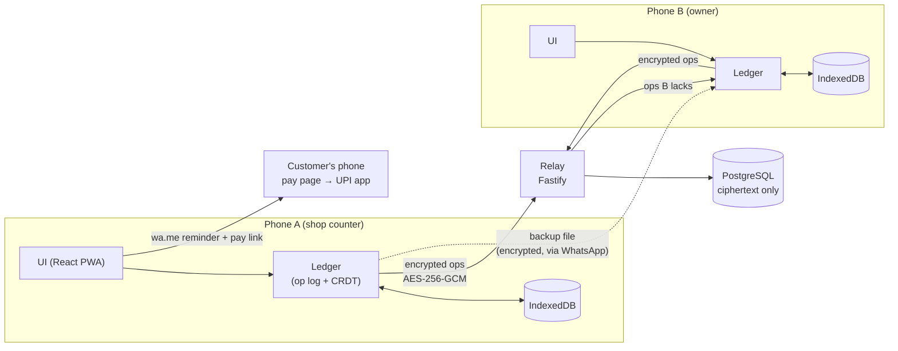

# How Hisaab works



## 1. The ledger is a set of operations

Every user action creates one immutable operation:

| op | meaning | merge rule |
|---|---|---|
| `cust` | new customer (name, phone) | creates; its id is the op id |
| `cset` | change name / phone / archived | last writer wins, per field |
| `entry` | udhaar given (`gave`) or payment received (`got`), integer paise | append-only |
| `void` | cancel an entry | tombstone; wins in any order |
| `set` | shop name, owner, UPI ID | last writer wins, per field |

What the screen shows is `reduce(set of ops)`, a pure function. It sorts operations by id, applies creations, then applies the field updates with the latest stamp, then sums the live entries. Because the result depends only on *which* operations are present, not on the order they arrived in, two phones holding the same operations always show identical balances. This is the definition of an operation-based CRDT.

`packages/core/test/ledger.test.ts` checks this directly:
- **Randomised histories:** 60 runs, each with 3 phones making about 80 random edits and random partial syncs (shuffled, with duplicates). At the end every phone, and a fresh `reduce` of the reversed op set, produce byte-identical JSON.
- **Balances add up:** every balance equals the sum of that customer's live entries.

## 2. Ordering with hybrid logical clocks

An op id is an HLC timestamp: `wall(base36).counter.device`. It sorts lexicographically in causal order. On receiving a remote op, the local clock moves past it, so an edit made *after seeing* another edit always sorts later, even on a phone whose clock is behind. Remote clocks more than 24 hours in the future are ignored for clock advancement, so one phone set to the wrong year cannot drag everyone forward. Restoring a backup onto a new phone restores the device's clock and sequence too.

## 3. Sync: version vectors, twice idempotent

Each op also carries `(dev, seq)`, a per-device counter. A replica summarises what it has as a version vector `{dev: highest contiguous seq}`. If seq 3 arrived after 4 and 5, the vector says 2 until 3 shows up.

A sync is:

1. **pull** `{token, vv}`. The relay returns the ops the phone lacks (paged), plus its own vector.
2. **push** `ledger.since(relayVV)`, in batches of 200.

Both steps are idempotent: re-sending stores nothing new, and re-pulling merges nothing new. A sync interrupted by a dropped 2G connection is simply run again. The relay computes its contiguous vector in SQL with a window function, so a lost batch is detected and re-sent.

## 4. End-to-end encryption

```
sync code (24 base32 chars, 120 bits, shown once, typed on the second phone)
  └─ HKDF-SHA256(salt "hisaab/v1")
       ├─ info "enc"  → AES-256-GCM key (never leaves the phone)
       ├─ info "id"   → shop id (128 bits, public routing key)
       └─ info "auth" → write token (relay stores SHA-256 only, compares in constant time)
```

- **What the relay sees.** Every operation is sealed separately: `{dev, seq, ct}` where `ct = AES-GCM(op, AAD = "op:dev:seq")`. Binding `(dev, seq)` as additional data means the relay cannot re-label, swap or replay ciphertexts under other coordinates; the phone verifies the decrypted op matches its envelope. The relay learns only how many operations a shop has and when they arrive.
- **Backup files.** The whole op log is sealed with the same key under AAD `backup:<shopId>`. A file from another shop is rejected with a clear message rather than a generic error.
- **Tests.** Tamper tests cover a flipped bit, a swapped payload, a re-labelled sequence and the wrong key. The e2e suite records every request body sent to the relay and asserts that names and amounts never appear in it.

## 5. The relay

The relay is Fastify with zod validation (strict schemas, size caps, base64url-only ciphertext). It has a per-IP rate limit, a per-shop quota, and PostgreSQL with check constraints and cascade deletes. Migrations run once each, inside a transaction, under an advisory lock. The same behavioural suite runs against the in-memory store and a real PostgreSQL (embedded-postgres locally, a service container in CI).

## 6. The app

- **Storage.** IndexedDB holds the op log, written with idempotent puts. The app asks the browser for persistent storage so the khata isn't evicted under storage pressure. If IndexedDB is unavailable, it says so instead of silently losing data.
- **Offline.** A build-time plugin writes `sw.js` listing the exact hashed assets: cache-first for the app shell and fonts, never for the relay.
- **Input.** A calculator keypad (no keyboard, no invalid input); a one-line parser ("रमेश 450", "pappu ko 500 do" is ₹500, not ₹502); Web Speech for hi-IN and en-IN.
- **Collection.**
  - `wa.me` deep links send the reminder text;
  - the pay page is a hash route that renders only what is in its URL: a QR and an NPCI `upi://pay` link;
  - the phone number is normalised from +91, 0-prefix, spaces and dashes;
  - the UPI ID is validated before it's saved.
- **Accessibility.** Hindi-first copy written the way shopkeepers talk, an `<html lang>` that switches with the language, labelled controls, visible focus, reduced-motion support, and every screen usable at 320 px width.
